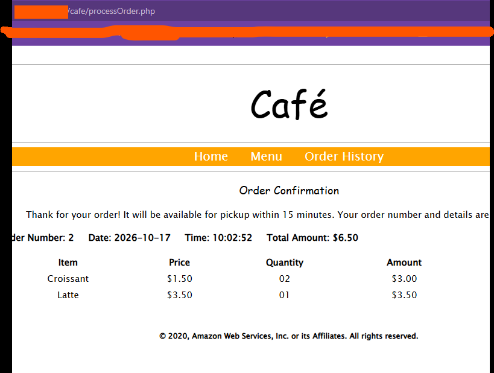
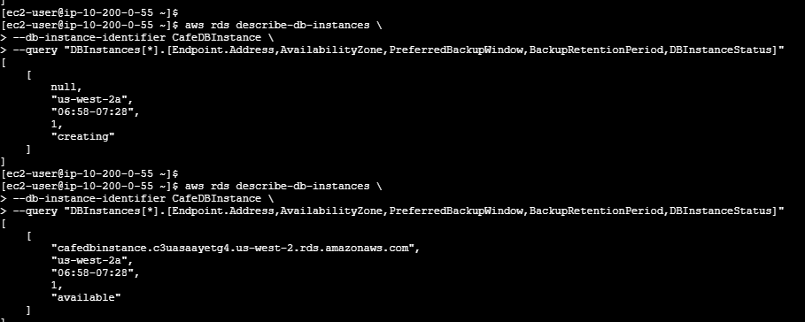
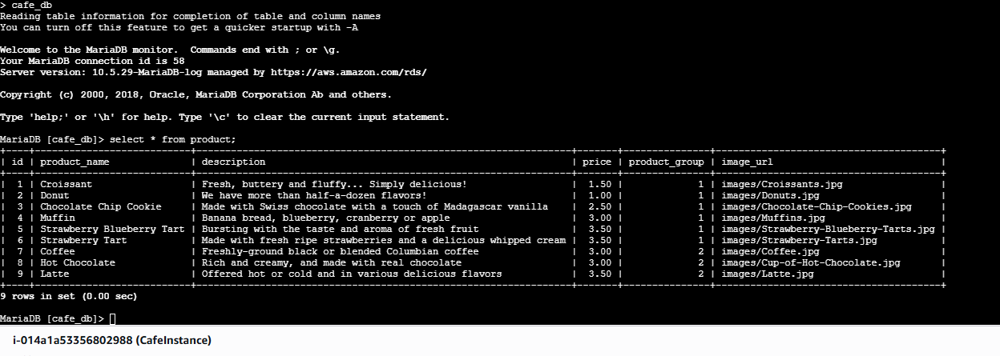
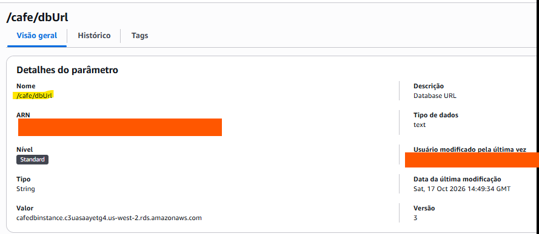
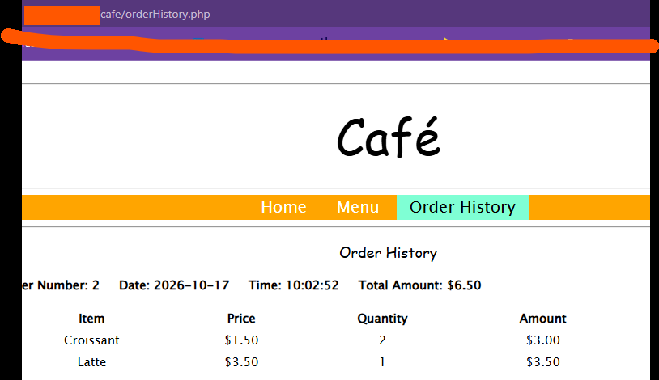

# Lab 179 – Migrar para o Amazon RDS

Laboratório prático da AWS (re/Start – Escola da Nuvem) em que migrei o banco de dados local de uma aplicação web de cafeteria para uma instância gerenciada **Amazon RDS (MariaDB)**, criada inteiramente pela **AWS CLI**.

## 🎯 Objetivos

- Configurar a AWS CLI em uma instância EC2 (CLI Host)
- Criar um security group, duas sub-redes privadas e um grupo de sub-redes de banco de dados
- Criar uma instância Amazon RDS MariaDB pela linha de comando
- Migrar os dados com `mysqldump` e `mysql`
- Apontar a aplicação para o novo banco via AWS Systems Manager (Parameter Store)
- Validar que os dados e o site continuam funcionando após a migração

## 🏗️ Arquitetura

| Componente | Função |
|---|---|
| **CafeInstance (EC2)** | Servidor web com a aplicação da cafeteria e o banco local original |
| **CLI Host (EC2)** | Instância usada para executar os comandos da AWS CLI |
| **CafeDBInstance (RDS MariaDB)** | Banco de dados gerenciado, sem acesso público (`db.t3.micro`, 20 GB) |
| **CafeDatabaseSG** | Security group que libera a porta 3306 apenas para o CafeSecurityGroup |
| **CafeDB Subnet Group** | Duas sub-redes privadas em Zonas de Disponibilidade diferentes |
| **Parameter Store (`/cafe/dbUrl`)** | Parâmetro com o endpoint do banco usado pela aplicação |

## 🛠️ Serviços e ferramentas

Amazon RDS · Amazon EC2 · Amazon VPC · AWS Systems Manager · AWS CLI · MariaDB · mysqldump

## 📋 Passo a passo

### 1. Pedido no site antes da migração
Fiz um pedido no site da cafeteria para gerar dados no banco local. O pedido nº 2 ficou registrado (2 Croissants e 1 Latte, total de US$ 6,50).



### 2. Rede, segurança e criação do RDS
No CLI Host, configurei a AWS CLI (`aws configure`) e criei:

- o security group `CafeDatabaseSG`, com regra de entrada TCP 3306 vinda apenas do `CafeSecurityGroup`;
- duas sub-redes privadas (`10.200.2.0/23` e `10.200.10.0/23`) em AZs diferentes;
- o grupo de sub-redes `CafeDB Subnet Group`;
- a instância `CafeDBInstance` (MariaDB, `db.t3.micro`, sem acesso público).

```bash
aws rds create-db-instance \
--db-instance-identifier CafeDBInstance \
--engine mariadb \
--engine-version <VERSAO_DISPONIVEL> \
--db-instance-class db.t3.micro \
--allocated-storage 20 \
--availability-zone <AZ_DA_CAFEINSTANCE> \
--db-subnet-group-name "CafeDB Subnet Group" \
--vpc-security-group-ids <ID_DO_CAFEDATABASESG> \
--no-publicly-accessible \
--master-username root --master-user-password '<SENHA>'
```

Acompanhei o status com `describe-db-instances`: o endpoint começou como `null` (status *creating*) e, depois de alguns minutos, apareceu com o status **available**.



### 3. Migração dos dados
Na CafeInstance, gerei o backup do banco local e restaurei no RDS:

```bash
mysqldump --user=root --password='<SENHA>' --databases cafe_db --add-drop-database > cafedb-backup.sql
mysql --user=root --password='<SENHA>' --host=<ENDPOINT_DO_RDS> < cafedb-backup.sql
```

Em seguida, conectei no RDS e consultei a tabela `product`. A consulta retornou os 9 produtos e o banner do servidor confirma o MariaDB gerenciado pelo Amazon RDS.



### 4. Aplicação apontando para o RDS
No Systems Manager, alterei o parâmetro `/cafe/dbUrl` para o endpoint do RDS, sem mexer no código da aplicação.



### 5. Validação final
Depois da troca do parâmetro, o histórico de pedidos do site mostrou o mesmo pedido nº 2 (mesma data, hora e valor), o que confirma que os dados foram migrados e que a aplicação lê do RDS.



## ✅ Resultados

- Banco de dados migrado com sucesso para o Amazon RDS
- Dados preservados: o pedido feito antes da migração aparece no histórico depois dela
- Aplicação funcionando com o novo banco alterando apenas um parâmetro
- Banco privado, acessível somente pela instância da aplicação

## ⚠️ Dificuldades e soluções

- **Versão do MariaDB:** o lab pede a versão 10.5.13, que não está mais disponível na AWS (erro `Cannot find version 10.5.13 for mariadb`). Listei as versões com `aws rds describe-db-engine-versions` e usei a **10.5.29**, da mesma linha, sem impacto no restante do lab.
- **Placeholders nos comandos:** colar `<ID>` com os sinais `< >` faz o bash interpretar como redirecionamento e o comando falha. É preciso trocar pelo valor real, sem os sinais.
- **Menu do Systems Manager:** no console em português, o Parameter Store aparece como **Armazém de parâmetros**, na seção *Ferramentas de aplicação*.

## 📚 Aprendizados

- Instâncias RDS exigem um grupo de sub-redes com pelo menos duas Zonas de Disponibilidade
- Security groups podem usar outro security group como origem, em vez de IPs
- Externalizar configurações no Parameter Store permite trocar de banco sem alterar o código
- Documentação de laboratório pode ficar desatualizada, e saber investigar o erro faz parte do trabalho

## ⚠️ Segurança

Credenciais, senhas, IDs de conta e endereços IP públicos foram removidos ou ocultados nos comandos e prints deste repositório.

## 👩‍💻 Autora

**LUCIANA RB DE ASSIS**

[LinkedIn](https://www.linkedin.com/in/lucianarbassis/) · [GitHub](https://github.com/alra-code)
